# 🔥 Prédire le risque de départ de feu de forêt – zone méditerranéenne

> **Quelle est la probabilité qu'un feu démarre dans une commune donnée, un jour donné ?**

Modèle de machine learning qui estime, pour chacune des **3 505 communes** des 15 départements méditerranéens et chaque jour, la probabilité d'au moins un départ de feu de forêt. Il s'appuie sur 10 ans de feux réels (BDIFF) et sur la météo journalière de Météo-France (SIM2, 31 ans). C'est le passage à l'échelle de mon [projet Bouches-du-Rhône](https://github.com/tomsduval-fr/incendies).

**👉 [Ouvrir le tableau de bord des scénarios 2027](outputs/carte_scenarios_2027.html)** · [version en ligne](https://tomsduval-fr.github.io/incendies-mediterranee/outputs/carte_scenarios_2027.html)

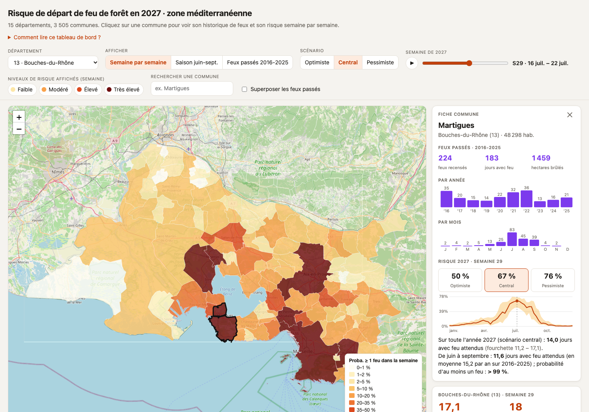

---

## En bref

| | |
|---|---|
| **Données** | 16 162 feux de forêt (2016-2025) · 15 départements · 3 505 communes · météo SIM2 sur 1 215 points de grille, 1995-2025 |
| **Table d'entraînement** | **12,8 millions** de lignes *commune × jour*, dont **0,12 %** avec feu |
| **Modèles comparés** | régression logistique, arbre de décision, forêt aléatoire, gradient boosting (scikit-learn) |
| **Modèle retenu** | `HistGradientBoostingClassifier` réglé, 26 features, entraîné sur un échantillon pondéré |
| **Évaluation** | découpage temporel : entraînement 2016-2020, validation 2021-2022, **test 2023-2025** |
| **Résultat (test)** | PR-AUC **0,0187** contre 0,0114 pour la baseline (**+64 %**) · en surveillant 5 % des couples commune × jour, on couvre **44 % des feux** (33 % pour la baseline) · meilleur que la baseline **chaque année et dans les 15 départements** |
| **Livrable** | tableau de bord web : risque hebdomadaire 2027 par commune, filtre par département, 3 scénarios issus de **30 années de météo** |

### Ce qui change par rapport au projet Bouches-du-Rhône

| | Bouches-du-Rhône | Zone méditerranéenne |
|---|---|---|
| Communes · lignes | 119 · 0,4 M | **3 505 · 12,8 M** |
| Météo | Open-Meteo (API limitée, cases de 0,1°) | **Météo-France SIM2** (fichiers open data, grille 8 km, **humidité des sols**) |
| Stockage | CSV | **Parquet** (types conservés, 20× plus compact) |
| Choix du modèle | gradient boosting directement | **4 familles comparées** avec le même protocole |
| Volume d'entraînement | tout le train | **sous-échantillonnage des négatifs pondéré** (8× plus rapide) |
| Calibration (test) | surestimation ≈ 25 % | **surestimation ≈ 12 %** |
| Scénarios 2027 | ensemble de 10 années de météo | **ensemble de 30 années** (1996-2025) |

---

## La démarche

Le projet est découpé en 9 notebooks rédigés comme un cours : chaque étape explique le *pourquoi* avant le code.

| # | Notebook | Ce qu'il fait |
|---|---|---|
| 01 | [Exploration](notebooks/01_exploration.ipynb) | Les 15 départements Prométhée concentrent 59 % des feux français. Deux saisons : l'été partout, la fin d'hiver (écobuage) en montagne. |
| 02 | [Communes et table commune × jour](notebooks/02_dataset.ipynb) | 3 505 communes (population, surface, contours simplifiés), rattachement des feux des **communes fusionnées** depuis 2016 (99,86 % des feux conservés), table de 12,8 M lignes en **Parquet**. |
| 03 | [Météo SIM2](notebooks/03_meteo.ipynb) | Rattachement de chaque commune au point de grille SAFRAN le plus proche (**BallTree**, distance haversine). Boucle *télécharger → extraire → supprimer*, année par année, relançable. |
| 04 | [Features](notebooks/04_features.ipynb) | Fenêtres glissantes calculées **par point météo** (3× moins de calculs), humidité des sols, jours sans pluie, densité de population, historique de feux **décalé d'un jour**, taux historique plutôt que compteur cumulé (dérive). |
| 05 | [Baseline](notebooks/05_baseline.ipynb) | Taux historique commune × mois, **lissé** vers le département (*shrinkage*) : PR-AUC 0,0157 en validation. |
| 06 | [Comparaison des modèles](notebooks/06_modele.ipynb) | Sous-échantillonnage pondéré, 4 familles de modèles, grille de réglage, importance par permutation, test final, sauvegarde du modèle (`joblib`). |
| 07 | [Cartes et calibration](notebooks/07_carte.ipynb) | Prévu vs réalisé (zone, année, département), courbe de calibration, carte du jour record, atlas du risque estival. |
| 08 | [Scénarios 2027](notebooks/08_scenarios_2027.ipynb) | Ensemble de 30 années de météo → quantiles P10 / P50 / P90 par commune, département et zone ; génération du tableau de bord. |
| 09 | [Comprendre le modèle](notebooks/09_comprendre_le_modele.ipynb) | Un arbre dessiné et suivi à la main, un gradient boosting codé en 10 lignes, dépendance partielle, explication d'une prédiction. |

### Choix de méthode clés

- **Une ligne = une commune × un jour.** La BDIFF ne liste que les jours *avec* feu : il a fallu fabriquer les 12,8 millions de combinaisons, dont les jours *sans* feu.
- **Pas de fuite de données.** Toute feature dérivée des feux est calculée **jusqu'à la veille** (`shift(1)`). La météo du jour est autorisée, car elle correspond à la prévision disponible le matin.
- **Découpage temporel, jamais aléatoire.** Le jeu de test 2023-2025 n'a été ouvert qu'une fois, après tous les choix.
- **PR-AUC plutôt qu'accuracy.** Avec 0,12 % de positifs, répondre toujours « pas de feu » donnerait 99,88 % d'accuracy.
- **Calculer au niveau le plus agrégé, puis joindre.** Les 3 505 communes partagent 1 215 points météo : les fenêtres glissantes sont calculées par point.
- **Sous-échantillonner les négatifs, avec des poids.** On garde tous les feux et 10 % des non-feux, chacun pesant 10. L'entraînement est 8× plus rapide, la qualité quasi identique et les probabilités restent au bon niveau.

---

## Résultats

### Quel modèle ? (validation 2021-2022)

| Modèle | PR-AUC | vs baseline | Feux dans le top 5 % | Temps |
|---|---|---|---|---|
| Baseline lissée commune × mois | 0,0157 | – | 33 % | – |
| HGB, réglages par défaut | 0,0136 | −14 % | 42 % | 4 s |
| Arbre de décision (profondeur 8) | 0,0153 | −3 % | 43 % | 9 s |
| Régression logistique | 0,0178 | +13 % | 36 % | 3 s |
| HGB sur tout le train (6,4 M lignes) | 0,0198 | +26 % | 46 % | 238 s |
| Forêt aléatoire (150 arbres) | 0,0206 | +31 % | 43 % | 168 s |
| **HGB réglé (échantillon pondéré)** | **0,0233** | **+48 %** | **47 %** | 51 s |

Le réglage décisif est `min_samples_leaf` élevé (5 000 lignes par feuille). Avec ≈ 7 800 feux en entraînement, des feuilles plus petites apprennent du bruit. Le **réglage** compte autant que le **choix** du modèle : le HGB par défaut fait moins bien que la baseline.

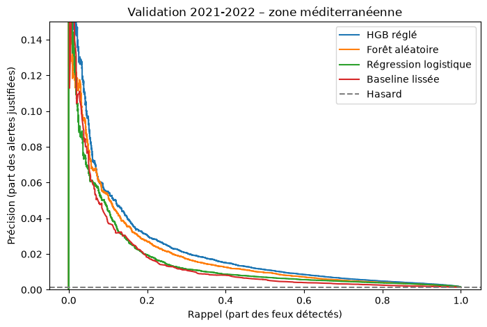

### Test 2023-2025 (4 137 jours-commune avec feu, jamais vus)

| | PR-AUC | Feux couverts en surveillant le top 5 % |
|---|---|---|
| Hasard | 0,0011 | 5 % |
| Baseline lissée commune × mois | 0,0114 | 33 % |
| **Gradient boosting** | **0,0187** | **44 %** |

Le modèle bat la baseline en 2023, 2024 et 2025, et dans **les 15 départements**. Le gain est le plus fort là où les feux sont dispersés et l'historique pauvre : **Lozère 15 % → 39 %**, **Ardèche 13 % → 36 %** des feux dans le top 5 % du département. Quand on ne peut pas s'appuyer sur « cette commune brûle souvent », la météo (humidité des sols, sécheresse) fait la différence.

**Journée record du test (8 juillet 2025, 30 communes en feu)** : Martigues était n°1 du classement du modèle, Istres n°4, Les Pennes-Mirabeau n°6, Aix-en-Provence n°8. 11 des 30 communes touchées étaient dans le top 100 (3 % des communes).

### Ce que le modèle a appris

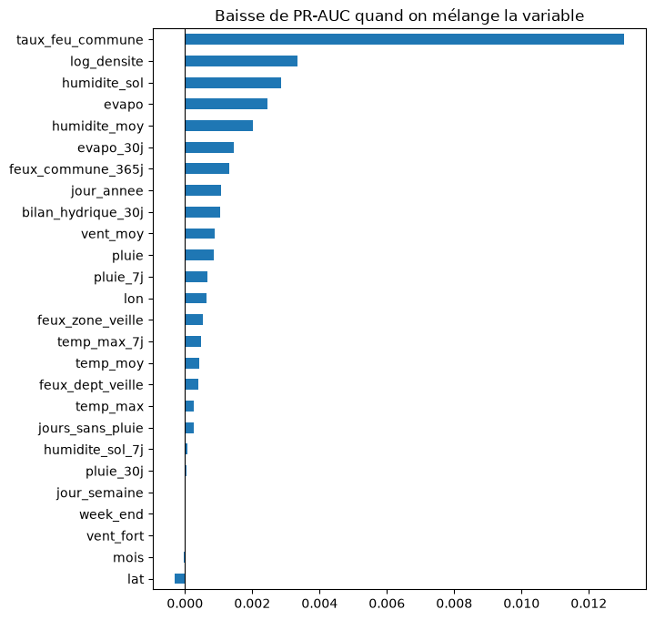

1. **L'historique de la commune** (taux de jours avec feu jusqu'à la veille) : *où* reste l'information n°1.
2. **La densité de population** : 90 % des feux sont d'origine humaine, et le risque augmente avec la présence humaine.
3. **La sécheresse** : humidité des sols (SIM2), évapotranspiration, humidité de l'air.

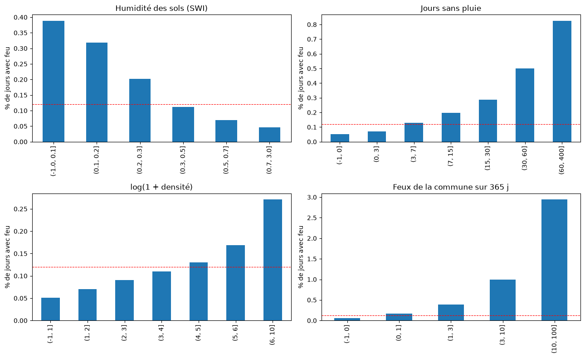

### Calibration : bien trier *et* annoncer le bon niveau

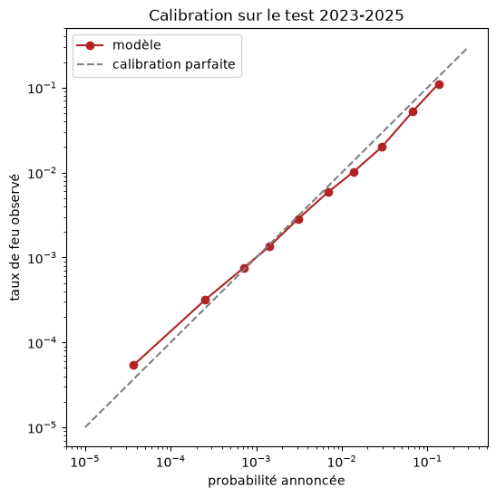

Sur 2023-2025, le modèle attendait **4 655** jours-commune avec feu pour **4 137** réels (+12 %). Les probabilités sont fiables jusqu'à ≈ 0,5 % (l'immense majorité des lignes) et surestimées de 15 à 45 % au-delà : quand le modèle annonce 13 %, on observe 11 %. Par département, c'est plus contrasté : les Pyrénées-Orientales sont surestimées (×2,7), le Var et les Hautes-Alpes sous-estimés (≈ −35 %). Une recalibration par département est une piste naturelle.

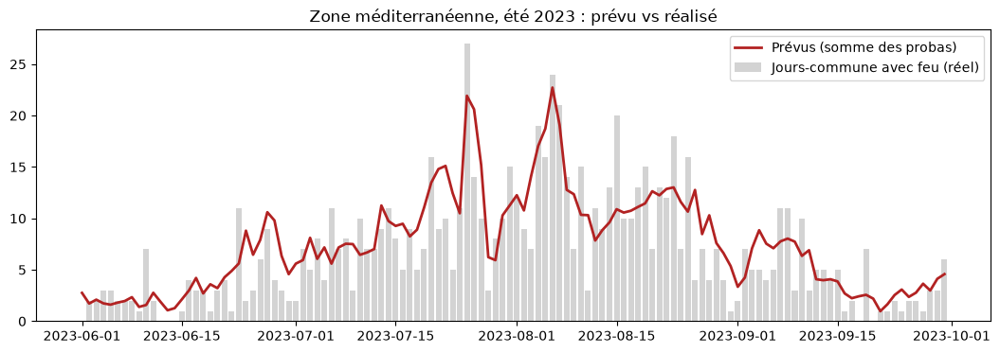

### Comment le modèle fonctionne (notebook 09)

Un **arbre de décision** à 3 niveaux pose d'abord la question de l'historique de la commune, puis celle de la sécheresse (bilan hydrique sur 30 jours) :

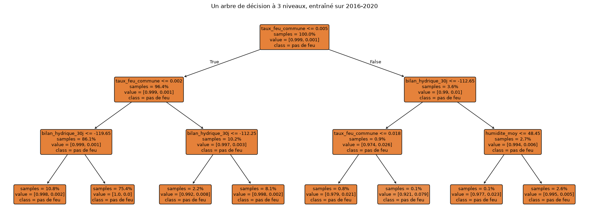

Le **gradient boosting** additionne 500 petits arbres, chacun corrigeant les erreurs des précédents. Pour Martigues le 16 juillet 2025 (feu réel ; mistral, 58 jours sans pluie), la prédiction part du taux moyen (0,12 %) et monte jusqu'à **29 %**. Pour un village agricole de la Drôme en hiver, elle descend à 0,0001 % :

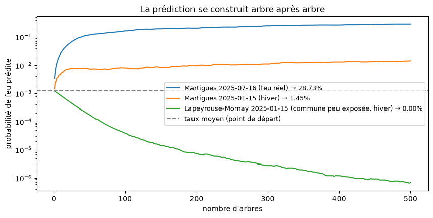

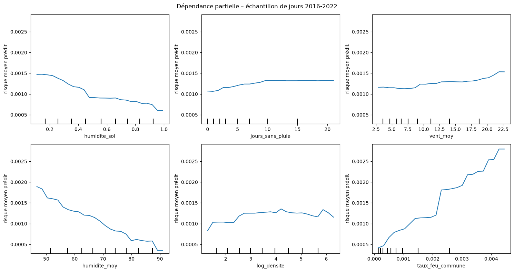

---

## Le tableau de bord des scénarios 2027

La météo de 2027 étant inconnue, la page ne prétend pas prédire un jour précis. Elle répond à une question de **planification** : *« dans une année typique, ou dans une mauvaise année sur dix, quelles communes surveiller, et à partir de quelle semaine ? »*

- **Un ensemble de 30 années de météo.** Le modèle, réentraîné sur 2016-2025, est rejoué avec la météo réelle de chaque année de 1996 à 2025. Le modèle a besoin des feux pour *apprendre*, mais les scénarios n'ont besoin que de *météo*. L'historique de feux des communes est celui connu fin 2025.
- **Trois niveaux** par commune et par semaine : **optimiste** (P10), **central** (médiane), **pessimiste** (P90). Pour un département ou la zone, les quantiles portent sur les totaux de chaque année de météo : on n'additionne pas des P90 communaux.
- **Filtres** : département (zoom, chiffres clés, graphique et classement recalculés), mode d'affichage (risque semaine par semaine · jours avec feu attendus de juin à septembre · feux passés 2016-2025), scénario, curseur et animation des semaines, niveaux de risque, recherche de commune (homonymes distingués par département), superposition des feux passés.
- **Fiche commune** (clic) : population, feux recensés, jours avec feu et hectares brûlés de 2016 à 2025, répartition par année et par mois, risque 2027 semaine par semaine avec sa fourchette, jours avec feu attendus.
- **Technique** : ≈ 550 000 valeurs précalculées et injectées dans une page HTML autonome (Leaflet, rendu canvas, probabilités stockées en ‰ entiers, contours simplifiés à 150 m) de 4,2 Mo, hébergeable gratuitement.

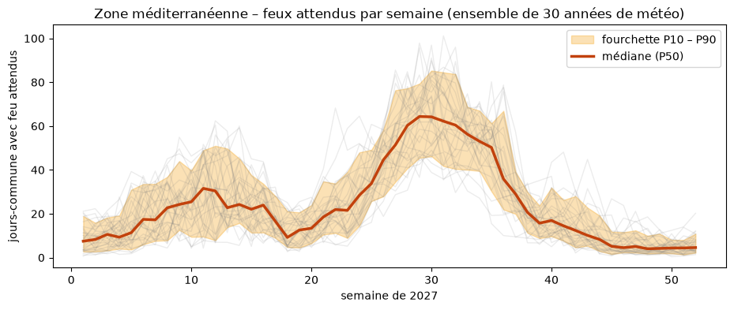

### Le réchauffement se voit dans l'ensemble

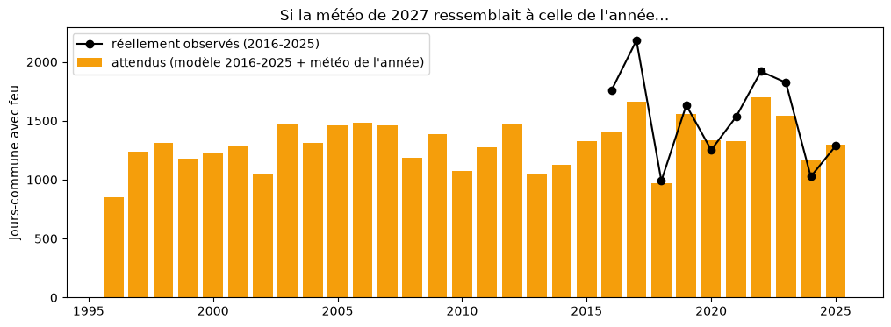

À modèle et communes identiques, la météo de 1996-2005 donne en moyenne **1 240** jours-commune avec feu par an, celle de 2006-2015 **1 283**, et celle de 2016-2025 **1 396** : **+13 %** en vingt ans. Les étés de 2022 et 2017 sont les plus dangereux de l'ensemble, celui de 1996 le plus clément. Le scénario central, qui mélange 30 étés, est donc plutôt un **plancher** pour 2027.

### Atlas du risque estival

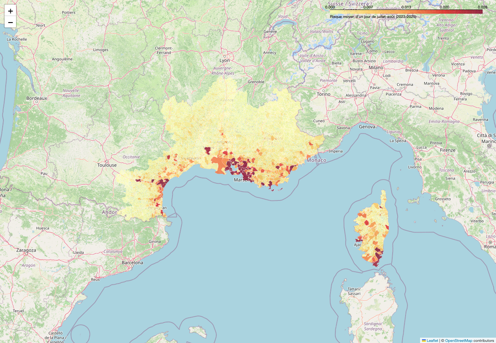

Les 10 % de communes jugées les plus risquées en juillet-août ont concentré **49 %** des jours de feu estivaux de 2023-2025. Autres cartes (folium) : [atlas du risque estival](outputs/atlas_risque_ete.html) · [8 juillet 2025, journée record](outputs/carte_risque_2025-07-08.html).

---

## Limites et pistes d'amélioration

- **Calibration par département** : niveau surestimé dans certains départements (Pyrénées-Orientales), sous-estimé dans d'autres (Var). Piste : recalibration isotonique par département sur les années récentes.
- **Journées extrêmes** : le 8 juillet 2025, le modèle attendait ≈ 20 communes en feu pour 30 réelles. Il voit *où* et *quand*, moins l'*ampleur* des emballements.
- **Vent et humidité moyens** : SIM2 fournit des moyennes journalières, pas le vent maximal ni l'humidité minimale. Les rafales de mistral sont lissées.
- **Végétation et occupation du sol** : aucune variable ne décrit la forêt, la garrigue ou l'interface habitat-forêt (piste : Corine Land Cover, BD Forêt).
- **Scénarios** : le climat de 2027 sera probablement plus chaud que la moyenne 1996-2025, et l'activité de feux de la veille est remplacée par une moyenne (les « emballements » sont lissés). Le niveau central est donc prudent. Piste : pondérer les années récentes.
- **Jours supposés indépendants** dans le calcul hebdomadaire.

---

## Structure du dépôt

```
incendies-mediterranee/
├── notebooks/        # 01 → 09, à exécuter dans l'ordre
├── src/
│   └── carte_scenarios_template.html   # gabarit HTML/JS du tableau de bord
├── outputs/          # tableau de bord et cartes HTML
├── images/           # figures du README
├── data/             # non versionné (régénéré par les notebooks 01 → 04, ≈ 0,8 Go)
│   ├── raw/          #   export BDIFF, grille SAFRAN, contours des communes
│   └── processed/    #   tables intermédiaires (Parquet), modèle (joblib)
└── requirements.txt
```

## Reproduire le projet

1. Exporter les feux depuis la [BDIFF](https://bdiff.agriculture.gouv.fr) : type de feu « Forêt », France entière, 01/01/2016 → 31/12/2025, format CSV. Enregistrer le fichier sous `data/raw/Incendies.csv`.
2. Installer l'environnement (Python 3.13) :
   ```bash
   python3 -m venv .venv
   source .venv/bin/activate
   pip install -r requirements.txt
   ```
3. Exécuter les notebooks de `notebooks/` **dans l'ordre**, depuis ce dossier. Le notebook 03 télécharge 31 fichiers SIM2 (≈ 137 Mo chacun, supprimés après extraction). Compter ≈ 1 h 30 pour toute la chaîne, dont ≈ 30 min pour la comparaison des modèles (06) et ≈ 15 min pour les scénarios (08).

## Sources des données

| Donnée | Source | Licence |
|---|---|---|
| Feux de forêt | [BDIFF](https://bdiff.agriculture.gouv.fr) – Ministère de l'Agriculture | données publiques |
| Météo journalière | [Météo-France, données SIM2 quotidiennes](https://www.data.gouv.fr/fr/datasets/donnees-changement-climatique-sim-quotidienne) | Licence Ouverte Etalab 2.0 |
| Communes, contours, population | [geo.api.gouv.fr](https://geo.api.gouv.fr) | Licence Ouverte Etalab 2.0 |
| Fond de carte | © contributeurs [OpenStreetMap](https://www.openstreetmap.org/copyright) | ODbL |

## Outils

Python 3.13 · pandas · pyarrow · scikit-learn · geopandas · matplotlib · folium · Leaflet · Jupyter
